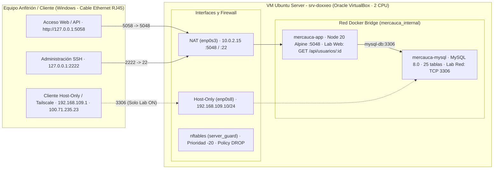

# MercaUca — Proyecto SED (Playbook Técnico y Documentación)

<p>
  
  
  
  
  
  
</p>

Plataforma universitaria de comercio electrónico **MercaUca** migrada a una arquitectura modular ligera (**Vanilla JS**, **Node.js / Express** y **MySQL 8.0**), contenerizada con **Docker Compose** sobre **Ubuntu Server** (`VirtualBox`) para prácticas académicas de desarrollo seguro y evaluación de vulnerabilidades controladas.

> [!NOTE]
> **Alcance de seguridad:** Este documento describe requerimientos, arquitectura, causa raíz técnica en código/configuración, impacto potencial y remediación. Por políticas de seguridad, **no incluye** guías ofensivas paso a paso, payloads ni comandos destinados a atacar o comprometer sistemas. Por defecto, los modos de laboratorio permanecen desactivados (`IDOR_LAB_MODE=false` y puerto `3306` no publicado).

---

## Tabla de Contenidos

- [1. Requerimientos (Software, Herramientas y Plugins)](#1-requerimientos-software-herramientas-y-plugins)
- [2. Estructura del Repositorio](#2-estructura-del-repositorio)
- [3. Puesta en Marcha Rápida](#3-puesta-en-marcha-rápida)
- [4. Infraestructura y Topología](#4-infraestructura-y-topología)
- [5. Superficie de Endpoints de la API](#5-superficie-de-endpoints-de-la-api)
- [6. Vulnerabilidades Implementadas (Análisis Técnico y Mitigación)](#6-vulnerabilidades-implementadas-análisis-técnico-y-mitigación)
- [7. Indicaciones Operativas y Logística de Evaluación](#7-indicaciones-operativas-y-logística-de-evaluación)
- [8. Resumen de vulnerabilidades](#resumen-de-vulnerabilidades)

---

## 1. Requerimientos (Software, Herramientas y Plugins)

### 1.1 Stack Base de Aplicación y Base de Datos

| Componente | Tecnología / Versión | Propósito en el proyecto |
| :--- | :--- | :--- |
| **Frontend** | HTML5, CSS3, Vanilla JS (ES6+) | Catálogo, buscador en vivo, carrito lateral, registro OTP, publicación y panel administrativo sin frameworks ni empaquetadores (`frontend/`). |
| **Estilos y Fuentes** | Google Fonts (`Staatliches`, `Plus Jakarta Sans`) | Tipografías importadas en `frontend/css/base.css` y diseño responsive en `frontend/css/responsive.css`. |
| **Backend** | Node.js 20 (`node:20-alpine`) + Express | API REST modularizada, autenticación JWT, sanitización de parámetros y servidor de estáticos (`backend/server.js`). |
| **Base de Datos** | MySQL 8.0 (InnoDB, `utf8mb4_unicode_ci`) | Persistencia relacional de usuarios, roles, productos, variantes, multimedia, carritos, órdenes y códigos OTP (`database/mercauca_mysql.sql`). |

### 1.2 Dependencias NPM del Backend (`backend/package.json`)

| Paquete | Versión | Función |
| :--- | :---: | :--- |
| `express` | `^4.21.2` | Enrutamiento HTTP, middlewares globales y servidor de archivos estáticos. |
| `mysql2` | `^3.12.0` | Driver MySQL con `mysql2/promise` y pool de conexiones parametrizadas (`backend/config/db.js`). |
| `jsonwebtoken` | `^9.0.2` | Firma y validación de tokens JWT en cookie `HttpOnly` o cabecera `Bearer` (`backend/middlewares/auth.js`). |
| `bcryptjs` | `^2.4.3` | Hash con salt y verificación segura de contraseñas (`backend/controllers/authController.js`). |
| `cors` | `^2.8.5` | Control de acceso entre orígenes con `credentials: true` y métodos permitidos. |
| `dotenv` | `^16.4.7` | Carga de variables de entorno desde `.env`. |
| `multer` | `^1.4.5-lts.1` | Procesamiento `multipart/form-data` en memoria (máx. 10 MB, solo imágenes en `backend/middlewares/upload.js`). |
| `nodemailer` | `^6.10.0` | Envío de correos SMTP HTML para códigos OTP de 6 dígitos y comprobantes de compra (`backend/utils/emailService.js`). |

### 1.3 Controles Nativos de Seguridad en el Backend

- **Cabeceras HTTP nativas (`backend/server.js`):** `X-Content-Type-Options: nosniff`, `X-Frame-Options: DENY`, `X-XSS-Protection`, `Referrer-Policy`, `Content-Security-Policy` y deshabilitación de `x-powered-by`.
- **Sanitización Global (`backend/middlewares/sanitizer.js`):** Bloqueo de Prototype Pollution (`__proto__`, `constructor`, `prototype`), bytes nulos y caracteres de control; límite JSON/URL-encoded de `1mb`.
- **Anti-Fuerza Bruta en Login (`backend/controllers/authController.js`):** Bloqueo temporal en memoria de 15 minutos tras 3 intentos fallidos (`429`).
- **Sesión `HttpOnly` y Anti-Caché:** JWT almacenado en cookie `HttpOnly` (sin exposición en `localStorage`) y `Cache-Control: no-store` en vistas HTML protegidas (`/admin*`, `/vender*`).

### 1.4 Herramientas de Infraestructura, Contenedores y Plugins

| Categoría | Herramienta / Plugin | Uso en el entorno |
| :--- | :--- | :--- |
| **Contenedores** | Docker Engine (`docker-ce`, `docker-ce-cli`, `containerd.io`) y Docker Desktop | Ejecución aislada de `mercauca-app` y `mercauca-mysql` en Ubuntu Server y Windows. |
| **Plugins Docker** | `docker-compose-plugin`, `docker-buildx-plugin` | Orquestación multi-contenedor (`docker-compose.yml` + `docker-compose.lab.yml`) y compilación (`Dockerfile`). |
| **Virtualización** | Oracle VirtualBox | Hospedaje de la VM Ubuntu Server (`srv-doxxeo`), reenvío de puertos NAT y adaptador Host-Only. |
| **Red, Firewall y SSH** | `systemd-networkd`, `nftables`, `ufw`, OpenSSH | Red aislada (`30-mercauca-lab.network`), tabla `inet server_guard` previa a Docker y administración SSH. |
| **Túnel Privado (opc.)** | Tailscale (`tailscale serve` TCP privado) | Enlace cifrado dentro de la tailnet hacia los puertos `5048` y `3306` de la VM sin Funnel público. |
| **Plugin Auth MySQL** | `caching_sha2_password` / `mysql_native_password` | Autenticación MySQL 8.0 con soporte TLS y verificación CA (`--ssl-mode=VERIFY_CA`). |
| **Automatización** | Bash, PowerShell, Python 3, `mysql.exe`, Git/GitHub, Chrome DevTools | Scripts `.bat`/`.sh` de respaldo y restauración, conmutación seguro/lab y verificación automatizada. |

---

## 2. Estructura del Repositorio

<details>
<summary>Ver árbol de archivos principal de <code>Proyecto SED</code></summary>

```text
Proyecto SED/
├── README.md                           # Documentación principal del repositorio (este archivo)
├── PLAYBOOK.md                         # Versión playbook consolidada para documentación
├── PLAYBOOK_IDOR.md                    # Nota técnica específica del laboratorio IDOR
├── PLAYBOOK_MercaUca_Proyecto_SED.pdf  # Versión PDF lista para presentación e impresión
├── docker-compose.yml                  # Compose completo (App + MySQL 8)
├── Dockerfile                          # Imagen Docker de mercauca-app (node:20-alpine, user node)
├── iniciar_bd_docker.bat               # Arranque rápido de BD Docker en Windows
├── detener_bd_docker.bat               # Detención segura de BD Docker en Windows
├── restaurar_bd_local.bat              # Restauración local de MySQL en Windows
├── backend/
│   ├── .env.example                    # Plantilla de variables de entorno
│   ├── package.json                    # Dependencias NPM de producción
│   ├── server.js                       # Punto de entrada Express, cabeceras y rutas
│   ├── config/
│   │   ├── db.js                       # Pool MySQL con mysql2/promise
│   │   └── idorLab.js                  # Guardián de entorno del escenario IDOR controlado
│   ├── controllers/                    # Controladores REST (auth, carrito, productos, admin, etc.)
│   ├── middlewares/                    # auth.js (JWT/roles), sanitizer.js, upload.js
│   ├── routes/                         # Rutas modularizadas de la API
│   └── utils/                          # emailService.js, otpStore.js, rolesHelper.js
├── database/
│   ├── mercauca_mysql.sql              # Esquema DDL + DML base
│   ├── seed_idor_lab.sql               # Cuentas ficticias @mercauca.test para pruebas
│   ├── cleanup_idor_lab.sql            # Limpieza de cuentas demo
│   ├── docker-compose.yml              # Compose local alternativo (puerto 3307:3306)
│   └── Dockerfile                      # Imagen MySQL precargada
├── frontend/                           # HTML5, CSS3 y Vanilla JS puro (catálogo, carrito, admin)
└── mercauca-ubuntu-deploy/             # Paquete de despliegue para Ubuntu Server (srv-doxxeo)
    ├── docker-compose.yml              # Compose seguro (MySQL sin puertos publicados)
    ├── docker-compose.lab.yml          # Overlay de laboratorio (TCP 3306 Host-Only + IDOR_LAB_MODE)
    ├── README_UBUNTU.md                # Guía completa de despliegue y evidencias en Ubuntu
    ├── evidence/                       # Evidencias JSON, reglas nftables y configuración de red
    └── scripts/                        # lab_on.sh, lab_off.sh, backup_db.sh, restore_db.sh, etc.
```

</details>

---

## 3. Puesta en Marcha Rápida

### 3.1 Despliegue con Docker Compose (Recomendado)

```bash
# 1. Preparar variables de entorno
cp backend/.env.example .env

# 2. Construir e iniciar servicios (App en :5048 + MySQL interno en :3306)
docker compose up -d --build
```

> [!TIP]
> En **Ubuntu Server** (`mercauca-ubuntu-deploy/`), usa `./scripts/restore_db.sh` para restaurar la base de datos inicial y `./scripts/verify_deployment.sh` para comprobar el estado integral. En **Windows local**, puedes usar `iniciar_bd_docker.bat` y `detener_bd_docker.bat` (puerto `3307`).

### 3.2 Ejecución Local sin Contenedor de App

```bash
cd backend
npm install
npm start        # Producción | o `npm run dev` con recarga automática
```

- **Frontend y API integrados:** `http://localhost:5048/` (o `http://127.0.0.1:5058/` mediante reenvío VirtualBox).
- **Verificación de salud:** `GET /api/health`

<details>
<summary>Usuarios de prueba y cuentas de laboratorio disponibles</summary>

**Cuentas base (`README.md` / esquema inicial):**

| Usuario | Contraseña | Rol | Nombre |
| :--- | :--- | :---: | :--- |
| `ProductoMediaSlider` | `123456` | Administrador | Product Media Slider |
| `leguzman14` | `123456` | Administrador | Luis Guzman |
| `U001` | `123456` | Comprador | Juan Pérez |
| `U002` | `123456` | Vendedor | María García |

**Cuentas ficticias de laboratorio (`database/seed_idor_lab.sql`, clave común `DemoIdor123*`):**
`demo_idor_a`, `demo_idor_b`, `lab_comprador_1`, `lab_comprador_2` (Comprador) y `lab_vendedor_1`, `lab_vendedor_2` (Vendedor).

</details>

---

## 4. Infraestructura y Topología

El despliegue en Ubuntu Server (`srv-doxxeo`, 2 CPU en Oracle VirtualBox) aísla los contenedores `mercauca-app` y `mercauca-mysql` dentro de la red bridge `mercauca_internal`, combinando reglas `nftables` previas a Docker (`inet server_guard`, política `drop`) y segmentación por interfaces:



### 4.1 Modos de Operación (Seguro vs. Laboratorio)

| Elemento | Modo Seguro (Predeterminado) | Modo Laboratorio (Académico) |
| :--- | :--- | :--- |
| **Archivos Compose** | `docker-compose.yml` (`bash scripts/lab_off.sh`) | `docker-compose.yml` + `docker-compose.lab.yml` (`bash scripts/lab_on.sh`) |
| **Aplicación Web / API** | `mercauca-app` en `:5048` (reenviado a `127.0.0.1:5058`) | `IDOR_LAB_MODE=true` e `IDOR_LAB_INSTANCE=mercauca-uca-lab` |
| **Base de Datos MySQL** | Solo interno (`expose: ["3306"]` en `mercauca_internal`) | Publicado en `192.168.109.10:3306:3306` (+ Tailscale Serve opcional) |
| **Cuentas y Cifrado DB** | Usuario no-root `mercauca_app`; `root@%` bloqueado | Conserva contraseñas fuertes, `caching_sha2_password`, TLS/CA y `root@%` bloqueado |

### 4.2 Segmentación de Red y Firewall (`srv-doxxeo`)

| Interfaz / Capa | Direccionamiento / Puerto | Regla aplicada (`server-firewall.nft` / VirtualBox) |
| :--- | :--- | :--- |
| **NAT (`enp0s3`)** | `10.0.2.15` · `5058→5048` / `2222→22` | Permite tráfico HTTP desde anfitrión (`10.0.2.2`) hacia `:5048`; no reenvía `3306`. |
| **Host-Only (`enp0s8`)** | `192.168.109.10/24` (sin gateway) | `nftables` permite TCP `3306` únicamente desde `192.168.109.1` y descarta cualquier otro origen. |
| **Tailscale (`tailscale0`)** | `100.71.235.23` (`:5048` y `:3306`) | Reenvío TCP privado mediante `tailscale serve` dentro de la tailnet autorizada (Funnel desactivado). |

---

## 5. Superficie de Endpoints de la API

| Grupo / Ruta API | Middleware / Control | Estado | Función |
| :--- | :--- | :---: | :--- |
| `POST /api/usuarios/login`, `/registro`, `/logout` | Sanitizador + Rate limit 3 intentos | Público | Autenticación, cookie JWT `HttpOnly` y registro como Comprador. |
| `GET /api/usuarios/perfil`, `/verify` | `verifyToken` (JWT) | Protegido | Retorna perfil autenticado y valida vigencia de sesión en BD. |
| `GET /api/usuarios/:idUsuario` | Condicional (`isIdorLabActive`) | **Lab IDOR** | Protegido en modo seguro; en laboratorio omite JWT y propiedad. |
| `POST /api/verificacion/*` | `otpStore` (expiración 5 min) | Público | Generación y validación de códigos OTP de 6 dígitos por correo. |
| `GET /api/productos*`, `/novedades/*`, `/search/*` | Consultas SQL parametrizadas | Público | Catálogo, detalle de producto, slider y búsqueda instantánea. |
| `POST /api/productos` | `verificarRolVendedor` + Multer | Rol VEN/ADM | Publicación de productos con imagen binaria en MySQL. |
| `GET /api/novedades/:id/nombre`, `/:id/email` | `verifyToken` (+ propio / ADM) | Protegido | Consulta controlada de nombre y correo electrónico de usuario. |
| `GET /api/novedades/AllUsers` | `verificarRolAdmin` | Solo Admin | Listado administrativo de cuentas registradas. |
| `/api/carrito/*` | `verifyToken` + `verificarAccesoRecurso` | Anti-IDOR | Gestión de carrito y checkout por propietario o Admin. |
| `/api/admin/*` | `verificarRolAdmin` | Solo Admin | Estadísticas, gestión de usuarios, productos, stock y órdenes. |

---

## 6. Vulnerabilidades Implementadas (Análisis Técnico y Mitigación)

### 6.1 Vulnerabilidad Web / API — IDOR (BOLA) y Ausencia de JWT en Consulta de Perfil

- **Clasificación:** OWASP Top 10 `A01:2021 - Broken Access Control` / OWASP API Security `API1:2023 - Broken Object Level Authorization (IDOR)`.
- **Endpoint afectado:** `GET /api/usuarios/:idUsuario` (`http://127.0.0.1:5058/api/usuarios/UserID` en el reenvío de la VM o `http://localhost:5048/api/usuarios/UserID` en ejecución local).
- **Archivos involucrados:** [`backend/routes/authRoutes.js`](backend/routes/authRoutes.js), `getById` en [`backend/controllers/authController.js`](backend/controllers/authController.js) y [`backend/config/idorLab.js`](backend/config/idorLab.js).
- **Causa raíz técnica:** La definición `router.get('/:idUsuario', authController.getById)` en `authRoutes.js` no aplica el middleware `verifyToken` a nivel de router. Dentro de `getById`, tanto la verificación del token JWT como la comprobación de propiedad (`esPropio || esAdmin`) quedan condicionadas a `if (!isIdorLabActive(req))`. Cuando `IDOR_LAB_MODE=true`, `IDOR_LAB_INSTANCE=mercauca-uca-lab` y el host está permitido en `IDOR_LAB_ALLOWED_HOSTS`, se omiten ambas validaciones y se ejecuta la consulta SQL directamente para cualquier `:idUsuario` recibido.
- **Aislamiento:** Se excluyen `password_hash` y secretos JWT; los demás endpoints (`/api/usuarios/perfil`, `/api/carrito/*`, `/api/admin/*`, `/api/novedades/AllUsers`) mantienen activos sus controles de sesión y roles.
- **Impacto potencial:** Exposición no autorizada de datos personales (`idUsuario`, `nombreUsuario`, `emailUsuario`, `telefonoUsuario`, `idRol`, `nombreRol`, `idEstado`) sin token JWT válido y posibilidad de enumeración de cuentas activas.
- **Mitigación recomendada:**
  1. Configurar `IDOR_LAB_MODE=false`, `IDOR_LAB_INSTANCE=disabled` o `PUBLIC_DEPLOYMENT=true`.
  2. Aplicar `verifyToken` directamente en `authRoutes.js` sobre `GET /:idUsuario`.
  3. Eliminar la bifurcación `isIdorLabActive(req)` en `getById` para exigir siempre `esPropio || esAdmin` (`403 Forbidden` en caso contrario).

### 6.2 Vulnerabilidad de Servidor / Red — Exposición del Puerto MySQL (`TCP 3306`)

- **Clasificación:** `CWE-284: Improper Access Control` / OWASP `A05:2021 - Security Misconfiguration`.
- **Servicio afectado:** `mysql-db` (`mercauca-mysql`, MySQL 8.0, puerto TCP `3306` publicado en `192.168.109.10:3306` y reenvío privado `100.71.235.23:3306` en modo laboratorio).
- **Archivos de configuración:** [`mercauca-ubuntu-deploy/docker-compose.lab.yml`](mercauca-ubuntu-deploy/docker-compose.lab.yml), [`mercauca-ubuntu-deploy/scripts/lab_on.sh`](mercauca-ubuntu-deploy/scripts/lab_on.sh) y [`mercauca-ubuntu-deploy/scripts/tailscale_mysql.py`](mercauca-ubuntu-deploy/scripts/tailscale_mysql.py).
- **Causa raíz técnica:** La aplicación requiere comunicarse con MySQL únicamente dentro de la red interna `mercauca_internal` (`expose: ["3306"]`). Al superponer `docker-compose.lab.yml`, se publica el puerto `3306` fuera de la red de contenedores, exponiendo directamente en red un servicio de persistencia interno (aun conservando autenticación `caching_sha2_password`, TLS/CA y bloqueo de `root@%`).
- **Impacto potencial:** Detección del puerto abierto, fingerprinting de versión (`MySQL 8.0`) e intentos de acceso o fuerza bruta directos al motor evadiendo las protecciones de la API REST; ante credenciales débiles o filtradas comprometería las 25 tablas del esquema `mercauca`.
- **Mitigación recomendada:**
  1. Retirar toda publicación externa ejecutando `bash scripts/lab_off.sh` en Ubuntu para volver a [`mercauca-ubuntu-deploy/docker-compose.yml`](mercauca-ubuntu-deploy/docker-compose.yml).
  2. Mantener la base de datos aislada en `mercauca_internal` (`mysql-db:3306`).
  3. Conservar `root@%` bloqueado, políticas `drop` en `nftables`/`ufw` y administración puntual exclusivamente mediante túnel SSH autenticado.

---

## 7. Indicaciones Operativas y Logística de Evaluación

> [!IMPORTANT]
> Lineamientos establecidos por el catedrático para la etapa final de evaluación:

1. **Ventana estricta de 30 minutos (VM):** En el horario inscrito se dispone únicamente de **30 minutos** para verificar el funcionamiento de las máquinas virtuales. Exceder este tiempo por fallos técnicos anula la nota del proyecto.
2. **Distribución de roles (3 Atacantes / 2 Documentadores):** El equipo se divide en **3 integrantes atacando** con acceso de red y **2 integrantes documentando** (sin acceso directo a la máquina virtual).
3. **Conectividad física Ethernet RJ45 obligatoria:** Los equipos de los atacantes deben contar con puerto **Ethernet RJ45** (o adaptador **USB a Ethernet**), ya que el sitio web solo será accesible mediante cable Ethernet.
4. **Segundo Playbook (Fase de Ataque):** Concluida la fase ofensiva sobre la máquina víctima asignada, se debe generar un segundo reporte con los hallazgos encontrados utilizando la plantilla compartida por el instructor **Diego Iraheta** en el aula virtual.

- [ ] Contenedores `mercauca-app` y `mercauca-mysql` en estado `Up / healthy`
- [ ] Endpoints `/api/health` y frontend respondiendo HTTP `200`
- [ ] Variables `.env` y respaldos SQL validados (25 tablas / 30 claves foráneas)
- [ ] Laptops del equipo atacante con entrada RJ45 o adaptador USB-Ethernet verificado

---

## Resumen de vulnerabilidades

| # | Vulnerabilidad / Hallazgo | Componente / Endpoint / Puerto | OWASP / CWE | Severidad | Descripción e impacto observado | Evidencia | Mitigación |
| :---: | :--- | :--- | :---: | :---: | :--- | :--- | :--- |
| 1 | **Endpoint no protegido** | `http://127.0.0.1:5058/api/usuarios/UserID` | IDOR | Alta | El endpoint no tiene una protección de JWT, por lo que ese endpoint es de acceso libre. | | Proteger la ruta del endpoint en el middleware. |
| 2 | **Puerto abierto** | `3306` | Puerto expuesto | Alta | La base de datos es accesible desde el puerto 3306. | | Cerrar el puerto 3306, ya que no es necesario. |
