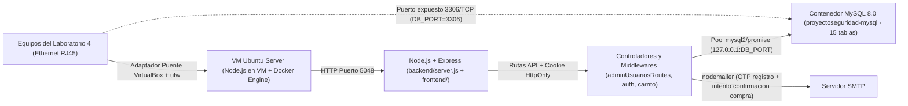

# MercaUca — Informe Técnico y Documentación del Proyecto (Proyecto SED)


-4479A1?style=flat-square&logo=mysql&logoColor=white)
%20%2B%20Ubuntu%20VM-2496ED?style=flat-square&logo=docker&logoColor=white)


> **Repositorio oficial a desplegar:** [`biiluu/ProyectoSeguridad`](https://github.com/biiluu/ProyectoSeguridad.git) (rama `main`)
> **Guía de instalación aparte:** [**GUIA_INSTALACION.md**](./GUIA_INSTALACION.md)

**Índice rápido:**
[1. Descripción y roles](#1-descripción-del-proyecto-y-roles-del-sistema) ·
[2. Arquitectura completa](#2-arquitectura-completa) ·
[3. Guía de instalación (30 min)](#3-guía-de-instalación-y-despliegue-paso-a-paso) ·
[4. Usuarios y credenciales](#4-usuarios-y-credenciales-de-prueba-para-cada-rol) ·
[5. Vulnerabilidades implementadas](#5-vulnerabilidades-implementadas) ·
[6. Flujo de trabajo en GitHub](#6-flujo-de-trabajo-en-github-utilizado)

---

## 1. Descripción del proyecto y roles del sistema

**MercaUca** (`Proyecto SED` / [`biiluu/ProyectoSeguridad`](https://github.com/biiluu/ProyectoSeguridad.git)) es una plataforma web de comercio electrónico universitaria orientada a la publicación, búsqueda, compra y administración de productos. En la configuración unificada que se desplegará en la máquina virtual Ubuntu Server del **Laboratorio 4**, el servidor web y la API REST se ejecutan directamente sobre **Node.js + Express** en el puerto `5048` (`backend/server.js`), mientras que **MySQL 8.0** se ejecuta en contenedor mediante `docker-compose.yml` (servicio `mysql-db`, contenedor `proyectoseguridad-mysql`, o MySQL nativo si se opta por instalar `mysql-server` en la VM) con un esquema de **15 tablas** definido en `database/mercauca_init.sql`.

### Roles funcionales del sistema

Los roles se almacenan en la tabla `roles` con identificadores SHA-256 definidos en `database/mercauca_init.sql` (y referenciados por `database/seed_admin.sql`), se resuelven mediante `backend/utils/rolesHelper.js` y se validan con los middlewares `verifyToken`, `verificarRolAdmin` (`backend/middlewares/auth.js`) y `verificarRolVendedor` (`backend/middlewares/verificarRolVendedor.js` / `auth.js`):

| Rol | Identificador SHA-256 en tabla `roles` | Responsabilidades y alcance en el sistema | Controles de acceso asociados |
| :--- | :--- | :--- | :--- |
| **Administrador** | `c2ef338fce5b8f9dc946f1dd77333f0f5000af62e379f7a92393eb8238cc18e6` | Administración de usuarios (`/api/admin/usuarios`), aprobación/moderación de productos (`/api/admin/productos`) y métricas operativas (`/api/admin`). | JWT en cookie `HttpOnly` (`token`), validación con `verifyToken` + `verificarRolAdmin` y protección server-side en `backend/server.js` para `/admin`, `/admin.html`, `/admin-usuarios.html`, `/admin-productos.html` y `/admin-ordenes.html`. |
| **Vendedor** | `e6497df97dd8170a661b99f9055b56f0b4cf8a92980936b1fa767959b28ecae6` | Publicación y edición de productos, variantes e imágenes (`/api/productos`, `/api/productos/mis-productos`, carga multimedia con `multer`) y gestión del catálogo propio. | JWT en cookie `HttpOnly` (`token`), validación con `verificarRolVendedor` y protección server-side en `backend/server.js` para `/vender`, `/vender.html`, `/mis-productos` y `/mis-productos.html`. |
| **Comprador** | `1c28919db40d671b4e4888de61fa3a1d47783e0a813b01c681d40e9047b95bbd` | Registro con verificación por correo electrónico (OTP), exploración y búsqueda de catálogo, gestión de carrito y órdenes (`/api/carrito`), y consulta de perfil propio. | JWT en cookie `HttpOnly` (`token`) validado por `verifyToken` en rutas privadas (`/api/usuarios/perfil`, `/api/usuarios/verify`, `/api/carrito`). |

### Distribución operativa en el Laboratorio 4

Para la sesión de evaluación en el **Laboratorio 4**, el tiempo de preparación, arranque y prueba de la máquina virtual está limitado estrictamente a **30 minutos**. La distribución del equipo de 5 integrantes contempla:

- **3 integrantes atacantes:** verifican acceso por **cable Ethernet RJ45** (o adaptador USB a Ethernet), única vía habilitada para visualizar y auditar el sitio web en el laboratorio.
- **2 integrantes documentadores:** no tienen acceso directo a la máquina virtual y documentan el reporte de hallazgos siguiendo la plantilla compartida por el instructor Diego Iraheta.

---

## 2. Arquitectura completa

### 2.1 Tecnologías utilizadas

| Capa | Tecnología / Paquete | Configuración y propósito en el proyecto |
| :--- | :--- | :--- |
| **Servidor web y API** | Node.js + `express` (`^4.21.2`) | Sirve los archivos estáticos de `frontend/` directamente en la VM y expone los grupos de rutas `/api/verificacion`, `/api/usuarios`, `/api/productos`, `/api/novedades`, `/api/search`, `/api/carrito`, `/api/admin/usuarios`, `/api/admin/productos`, `/api/admin` y `/api/health` en el puerto `5048` (`backend/server.js`). |
| **Autenticación y criptografía** | `jsonwebtoken` (`^9.0.2`), `bcryptjs` (`^2.4.3`) | Emisión y verificación de tokens JWT almacenados en cookie `HttpOnly` (`token`), hashing de contraseñas y control de intentos fallidos (`intentosLogin` en `backend/controllers/sesionController.js`: bloqueo temporal de 15 minutos tras 3 fallos con HTTP `429`). |
| **Base de datos** | MySQL 8.0 + `mysql2` (`^3.12.0`) | Pool asíncrono `mysql2/promise` configurado en `backend/config/db.js` mediante `DB_HOST`, `DB_PORT`, `DB_USER`, `DB_PASSWORD` y `DB_NAME`. |
| **Seguridad web y entrada** | `cors` (`^2.8.5`), `dotenv` (`^16.4.7`), `globalSanitizer`, cabeceras nativas | `app.disable('x-powered-by')`, CORS con `credentials: true`, límite JSON de `1mb`, sanitización en `backend/middlewares/sanitizer.js`, cabeceras `X-Content-Type-Options`, `X-Frame-Options: DENY`, `X-XSS-Protection`, `Referrer-Policy`, CSP y anti-caché en HTML. |
| **Multimedia y correo electrónico (SMTP)** | `multer` (`^1.4.5-lts.1`), `nodemailer` (`^6.10.0`) | Carga de imágenes de productos (`backend/middlewares/upload.js`) y envío SMTP (`backend/utils/emailService.js`) utilizado tanto para enviar códigos OTP de verificación en el registro (`verificacionController.js` / `POST /api/verificacion/enviar-codigo`) como para intentar enviar el correo de confirmación de compra al finalizar un pedido (`carritoController.js` / `POST /api/carrito/finalizar-compra/:idUsuario`, dentro de `try/catch`: si falla el SMTP la orden igual se confirma con `HTTP 200` y `correoEnviado: false`). |
| **Frontend** | HTML5, CSS3, JavaScript modular | Hojas de estilo en `frontend/css/`, configuración API en `frontend/js/config.js`, lógica de sesión y perfil en `frontend/js/auth.js`, vistas administrativas/vendedor y página `404.html`. |
| **Virtualización y contenedores** | VirtualBox + Ubuntu Server, Docker Engine (`docker-compose-plugin`) | En la VM Linux Server, `docker-compose.yml` levanta **únicamente** MySQL (`proyectoseguridad-mysql`, mapeo `${DB_PORT:-3308}:3306`, configurable con `DB_PORT=3306` en laboratorio) mientras Node.js corre directamente en la VM (`:5048`). Red VirtualBox en **Adaptador Puente (Bridged Adapter)** para acceso por Ethernet desde otras computadoras físicas. |
| **Herramientas, plugins y utilidades** | OpenSSH, `ufw`, Git / GitHub, `curl`, `mysql-client`, `node --test`, Google Fonts (`Staatliches`, `Plus Jakarta Sans`), `caching_sha2_password` | Administración remota SSH, reglas de firewall, flujo Git/GitHub, comprobación HTTP/TCP, pruebas automatizadas de integración y tipografía web. |

### 2.2 Base de datos (MySQL 8.0 — 15 tablas)

El esquema relacional oficial definido en `database/mercauca_init.sql` (repositorio `biiluu/ProyectoSeguridad`) consta de **15 tablas** organizadas en tres dominios funcionales:

- **Identidad, roles y verificación (4):** `roles`, `estado_usuario`, `usuario`, `codigos_verificacion`.
- **Catálogo, variantes y multimedia (5):** `categoria`, `condicion_producto`, `productos`, `variantes_productos`, `producto_media`.
- **Carrito y órdenes de compra (6):** `carrito`, `articulos_carrito`, `estados_orden`, `orden`, `estado_articulos_orden`, `articulos_orden`.

### 2.3 Estructura de carpetas

<details>
<summary>Ver estructura verificada del repositorio oficial a desplegar (biiluu/ProyectoSeguridad)</summary>

```text
ProyectoSeguridad/
├── .gitignore                                    # Ignora node_modules/, .env y .env.*; conserva !.env.example
├── docker-compose.yml                            # Servicio único mysql-db (proyectoseguridad-mysql, ${DB_PORT:-3308}:3306)
├── README.md                                     # Informe técnico obligatorio del proyecto
├── GUIA_INSTALACION.md                           # Guía detallada aparte de instalación en VM Ubuntu Server
├── backend/
│   ├── .env.example                              # Plantilla sin secretos reales (PORT, DB_*, JWT_*, COOKIE_SECURE, SMTP_*)
│   ├── package.json                              # Dependencias Express/MySQL/JWT/bcrypt/multer/nodemailer y scripts
│   ├── package-lock.json                         # Versiones fijadas para instalación reproducible (npm ci)
│   ├── server.js                                 # Servidor HTTP/API en puerto 5048, cabeceras, rutas API, HTML protegidas y 404
│   ├── config/
│   │   └── db.js                                 # Pool mysql2/promise con variables DB_HOST/DB_PORT/DB_USER/DB_PASSWORD/DB_NAME
│   ├── controllers/
│   │   ├── adminDashboardController.js           # Métricas y panel administrativo (/api/admin)
│   │   ├── adminProductosController.js           # Moderación/aprobación de productos (/api/admin/productos)
│   │   ├── adminUsuariosController.js            # Gestión de usuarios (/api/admin/usuarios); incluye consultarUsuario (GET /:id)
│   │   ├── carritoController.js                  # Carrito y checkout (finalizarCompra intenta enviar confirmación por SMTP)
│   │   ├── misProductosController.js             # Gestión del catálogo propio del vendedor
│   │   ├── novedadesController.js                # Consulta de novedades
│   │   ├── productosController.js                # Catálogo público, detalle y creación de productos
│   │   ├── registroController.js                 # Registro de cuentas nuevas
│   │   ├── searchController.js                   # Búsqueda de productos
│   │   ├── sesionController.js                   # Login, logout, perfil, verify y bloqueo intentosLogin (15 min)
│   │   └── verificacionController.js             # Envío y validación de códigos OTP por SMTP
│   ├── middlewares/
│   │   ├── auth.js                               # extractToken, verifyToken, verificarRolAdmin y verificarRolVendedor
│   │   ├── sanitizer.js                          # Middleware globalSanitizer de sanitización de entradas
│   │   ├── upload.js                             # Configuración de multer para imágenes
│   │   ├── verificarCorreoRegistro.js            # Validación previa de correo verificado en registro
│   │   └── verificarRolVendedor.js               # Middleware específico de acceso para Vendedor/Administrador
│   ├── routes/
│   │   ├── adminDashboardRoutes.js               # Rutas /api/admin
│   │   ├── adminProductosRoutes.js               # Rutas /api/admin/productos
│   │   ├── adminUsuariosRoutes.js                # Rutas /api/admin/usuarios (línea 17: GET /:id solo con verifyToken)
│   │   ├── carritoRoutes.js                      # Rutas /api/carrito
│   │   ├── novedadesRoutes.js                    # Rutas /api/novedades
│   │   ├── productosRoutes.js                    # Rutas /api/productos
│   │   ├── registroRoutes.js                     # Ruta POST /api/usuarios/registro
│   │   ├── searchRoutes.js                       # Rutas /api/search
│   │   ├── sesionRoutes.js                       # Rutas /api/usuarios (/login, /logout, /perfil, /verify)
│   │   └── verificacionRoutes.js                 # Rutas /api/verificacion (/enviar-codigo, /verificar-codigo)
│   ├── tests/
│   │   ├── integracion.test.js                   # Pruebas automatizadas con pool simulado (Test #3 verifica IDOR GET /:id)
│   │   └── productos.test.js                     # Pruebas de controlador de productos
│   └── utils/
│       ├── authSecrets.js                        # Lectura de JWT_SECRET y REGISTRO_TOKEN_SECRET
│       ├── emailService.js                       # Envío SMTP (enviarCorreoCodigo y enviarCorreoCompra)
│       ├── imagenProducto.js                     # Utilidades de imágenes de producto
│       ├── otpStore.js                           # Almacenamiento de códigos OTP
│       └── rolesHelper.js                        # Resolución de roles SHA-256 en tabla roles
├── database/
│   ├── mercauca_init.sql                         # Esquema unificado idempotente (15 tablas, catálogos y 4 usuarios base)
│   ├── seed_admin.sql                            # Inserción idempotente de admin01 y U001
│   ├── verificacion.sql                          # Script modular de verificación
│   ├── catalogo_productos.sql                    # Script modular de catálogo
│   ├── carrito.sql                               # Script modular de carrito
│   └── compras.sql                               # Script modular de órdenes
├── docs/
│   └── modulo-productos-vendedor.md              # Documentación funcional del módulo vendedor
└── frontend/
    ├── index.html, login.html, registro.html, producto.html, 404.html
    ├── vender.html, mis-productos.html           # Vistas de vendedor (protección server-side en server.js)
    ├── admin.html, admin-usuarios.html, admin-productos.html, admin-ordenes.html
    ├── assets/
    ├── css/                                      # Estilos modulares (base.css, topbar.css, admin.css, etc.)
    └── js/                                       # auth.js (?idUsuario=), admin-usuarios.js, config.js, api.js, cart.js, etc.
```

</details>

### 2.4 Diagrama de arquitectura



---

## 3. Guía de instalación y despliegue paso a paso

> **Guía completa aparte:** Consulta [**GUIA_INSTALACION.md**](./GUIA_INSTALACION.md) para el paso a paso detallado desde la creación de la VM Linux Server, modo sin Internet (offline), explicación de `backend/.env` sin publicar secretos, preparación de cuentas en la VM y verificación desde otra computadora física por cable Ethernet.

Esta sección resume el despliegue unificado del repositorio oficial [`biiluu/ProyectoSeguridad`](https://github.com/biiluu/ProyectoSeguridad.git) optimizado para completarse dentro de los **30 minutos asignados en el Laboratorio 4**.

### Cronograma objetivo (30 minutos en Laboratorio 4)

| Ventana de tiempo | Fase | Entregable verificable |
| :--- | :--- | :--- |
| **00 – 08 min** | Arranque de VM Ubuntu Server y red en **Adaptador Puente** | Interfaz física Ethernet enlazada; IP asignada consultada en la VM con `ip -4 addr show` |
| **08 – 15 min** | Verificación/instalación de Node.js 20 LTS, Docker Engine (`docker-compose-plugin`) y `ufw` | `node -v`, `npm -v` y `docker compose version` operativos |
| **15 – 23 min** | Clonado de `ProyectoSeguridad`, `backend/.env`, contenedor MySQL y dependencias npm | `proyectoseguridad-mysql` levantado con 15 tablas (`mercauca_init.sql`) y `npm install` listo en `backend/` |
| **23 – 30 min** | Ajuste de claves de prueba en VM, arranque de Node.js (`:5048`) y validación por Ethernet | `/api/health` en HTTP 200 y acceso verificado desde otra laptop física por cable Ethernet *(pendiente en VM)* |

### Paso 1: Creación y configuración de red de la máquina virtual (VirtualBox)

1. Crear o preparar una VM en **VirtualBox** con **Ubuntu Server** (22.04 LTS o 24.04 LTS), **2 vCPU**, al menos **2048 MB de RAM** (4096 MB recomendados), disco de **20 GB** y **OpenSSH Server**.
2. Configurar **Adaptador 1 en Adaptador Puente (Bridged Adapter)** seleccionando la interfaz física **Ethernet RJ45** (o adaptador USB-Ethernet) conectada a la red del Laboratorio 4.
   - **Diferencia con Red Solo-Anfitrión (Host-Only) o NAT (`127.0.0.1`):** Host-Only y NAT únicamente comunican la máquina anfitriona con su propia VM y **no permiten** comprobar el sitio web ni el puerto MySQL desde otra computadora física conectada por Ethernet en el laboratorio.
3. En la VM, abrir los puertos necesarios en `ufw` (pendiente de comprobar en laboratorio según reglas finales): `sudo ufw allow 5048/tcp` (web/API) y, únicamente al demostrar la vulnerabilidad del servidor, `sudo ufw allow 3306/tcp`.

### Paso 2: Instalación de Node.js, Docker y herramientas en Ubuntu Server

Conectar a la VM por consola de VirtualBox o SSH y ejecutar:

```bash
sudo apt-get update
sudo apt-get install -y git curl ca-certificates gnupg mysql-client docker.io docker-compose-plugin
sudo systemctl enable --now docker
sudo usermod -aG docker "$USER"

# Node.js 20 LTS (para ejecutar backend/server.js directamente en la VM)
curl -fsSL https://deb.nodesource.com/setup_20.x | sudo -E bash -
sudo apt-get install -y nodejs
```

*(Alternativamente, si no se usa contenedor Docker para la BD, instalar `mysql-server` nativo en `:3306`. Para entornos sin Internet en el laboratorio, pre-exportar `mysql:8.0` con `docker save` y pre-instalar `node_modules` como detalla [`GUIA_INSTALACION.md`](./GUIA_INSTALACION.md).)*

### Paso 3: Descarga del repositorio, configuración de `.env` e inicio de MySQL y Node.js

Indicar siempre la carpeta de trabajo en cada bloque de comandos:

1. Clonar el repositorio oficial en `$HOME` (`~`) y crear `backend/.env` desde [`backend/.env.example`](./backend/.env.example) (sin subir `.env` a Git):
   ```bash
   cd ~
   git clone https://github.com/biiluu/ProyectoSeguridad.git
   cd ~/ProyectoSeguridad/backend
   cp .env.example .env
   nano .env
   ```
   - Ajustar `PORT=5048`, `NODE_ENV=production` (exige `JWT_SECRET` y `REGISTRO_TOKEN_SECRET` definidos), `COOKIE_SECURE=false` (obligatorio mientras el laboratorio sirva por HTTP sin TLS), `DB_HOST=127.0.0.1`, `DB_PORT=3308` (o `DB_PORT=3306` si se publica el puerto `3306` para la demostración) y `DB_USER=root` / `DB_PASSWORD=root`.
   - Configurar `SMTP_*` considerando que el código utiliza SMTP tanto para enviar códigos OTP en el registro (`POST /api/verificacion/enviar-codigo`) como para intentar enviar el correo de confirmación de compra al finalizar una orden (`POST /api/carrito/finalizar-compra/:idUsuario`, donde si falla el SMTP la orden igual se registra con `correoEnviado: false`).
2. Instalar dependencias Node.js dentro de `~/ProyectoSeguridad/backend`:
   ```bash
   cd ~/ProyectoSeguridad/backend
   npm install
   ```
3. Levantar el contenedor MySQL desde la raíz `~/ProyectoSeguridad` (donde vive `docker-compose.yml`):
   ```bash
   cd ~/ProyectoSeguridad
   # Opción A (puerto por defecto del compose: 3308):
   docker compose up -d
   # Opción B (para exponer el puerto 3306 en la prueba de vulnerabilidad del servidor):
   DB_PORT=3306 docker compose up -d
   ```

### Paso 4: Carga de base de datos, consecuencias de re-ejecución SQL y arranque web

1. Cuando el volumen `proyectoseguridad_mysql_data` inicia vacío, Docker ejecuta automáticamente `database/mercauca_init.sql`, creando la base `mercauca` con **15 tablas**, catálogos, productos y 4 registros base en `usuario`.
2. **Consecuencia de volver a ejecutar los SQL sobre una base existente:** tanto `database/mercauca_init.sql` como `database/seed_admin.sql` son **idempotentes** (`CREATE DATABASE IF NOT EXISTS`, `CREATE TABLE IF NOT EXISTS`, `INSERT IGNORE INTO` y migraciones condicionales por `INFORMATION_SCHEMA.COLUMNS`). Re-ejecutarlos **no elimina tablas ni órdenes existentes ni sobrescribe contraseñas ya cambiadas en la VM**; únicamente inserta filas semilla faltantes:
   ```bash
   cd ~/ProyectoSeguridad
   docker exec -i proyectoseguridad-mysql mysql -uroot -proot < database/mercauca_init.sql
   docker exec -i proyectoseguridad-mysql mysql -uroot -proot < database/seed_admin.sql
   ```
3. En la VM de pruebas, asignar contraseñas temporales conocidas a las cuentas de prueba (`admin01`, `U001`, `U002`) siguiendo la Sección 4 y el Paso 8 de [`GUIA_INSTALACION.md`](./GUIA_INSTALACION.md) sin modificar los archivos SQL versionados.
4. Iniciar el servidor Node.js desde `~/ProyectoSeguridad/backend`:
   ```bash
   cd ~/ProyectoSeguridad/backend
   npm start
   ```

### Paso 5: Verificación de servicios y conectividad

1. **En la VM (respetando la carpeta de cada comando):**
   ```bash
   # Contenedor MySQL y 15 tablas (desde la raíz donde está docker-compose.yml):
   cd ~/ProyectoSeguridad
   docker compose ps
   docker exec proyectoseguridad-mysql mysql -uroot -proot -D mercauca -e "SHOW TABLES;"

   # Suite de pruebas automatizadas en memoria (desde backend/):
   cd ~/ProyectoSeguridad/backend
   node --test tests/*.test.js

   # Salud HTTP de Express (:5048), puertos abiertos e IP Ethernet de la VM:
   curl -i http://127.0.0.1:5048/api/health
   ss -tulpn | grep -E "5048|3308|3306"
   ip -4 addr show
   ```
2. **Desde otra computadora física conectada por cable Ethernet (pendiente en VM):** comprobar acceso web a `http://<IP_VM>:5048/` y `/api/health`, y validar la exposición o cierre del puerto `3306/TCP` tal como detalla la Sección 10.2 de [`GUIA_INSTALACION.md`](./GUIA_INSTALACION.md).

---

## 4. Usuarios y credenciales de prueba para cada rol

Las siguientes cuentas de prueba se insertan mediante `database/mercauca_init.sql` (y `database/seed_admin.sql`) en el repositorio oficial [`biiluu/ProyectoSeguridad`](https://github.com/biiluu/ProyectoSeguridad.git):

| Usuario / ID | Contraseña en entorno de prueba (VM) | Rol en el sistema | Correo registrado | Origen de semilla |
| :--- | :--- | :--- | :--- | :--- |
| `admin01` *(Administrador de Prueba)* | Asignada temporalmente en MySQL de la VM *(p. ej. `Prueba2026*` tras ejecutar el Paso 8 de [`GUIA_INSTALACION.md`](./GUIA_INSTALACION.md))* | `Administrador` | `admin01@mercauca.edu.sv` | `database/mercauca_init.sql` y `database/seed_admin.sql` |
| `U002` *(María García)* | Asignada temporalmente en MySQL de la VM *(mismo procedimiento en VM)* | `Vendedor` | `maria.garcia@example.com` | `database/mercauca_init.sql` |
| `U001` *(Juan Pérez)* | Asignada temporalmente en MySQL de la VM *(mismo procedimiento en VM)* | `Comprador` | `juan.perez@example.com` | `database/mercauca_init.sql` y `database/seed_admin.sql` |
| `ProductoMediaSlider` | *Cuenta técnica del slider promocional (no operativa para pruebas manuales)* | `Administrador` | `slider@mercauca.edu.sv` | `database/mercauca_init.sql` |

> **Nota sobre actualización de credenciales exclusivamente en la VM de pruebas:** El hash bcrypt guardado en `database/mercauca_init.sql` y `database/seed_admin.sql` (`$2a$10$qodyMehIheS3.eAQCxZ3kuEcDngKfEr2nurqxhuY9hyON6yTStD6u`) no incluye su contraseña en claro en el repositorio. Para iniciar sesión en los 3 roles durante las pruebas del laboratorio sin modificar los archivos SQL del repositorio, actualiza únicamente los registros de la base de datos dentro de la **VM del entorno de prueba** siguiendo el Paso 8 de [**GUIA_INSTALACION.md**](./GUIA_INSTALACION.md) (o registra cuentas `Comprador` nuevas vía `/registro.html` si SMTP está configurado).

---

## 5. Vulnerabilidades implementadas

A continuación se documentan únicamente la vulnerabilidad web implementada en la aplicación y la vulnerabilidad de servidor prevista para la auditoría del laboratorio, distinguiendo entre lo comprobado en código/pruebas y lo pendiente de validar en la máquina virtual final.

### 5.1 Vulnerabilidad Web — IDOR en consulta de usuarios (`GET /api/admin/usuarios/:id`)

- **Qué es:** Referencia Directa a Objeto Insegura (**IDOR** / *Broken Object Level Authorization*, OWASP `A01:2021` · `API1:2023`) sobre el endpoint **`GET /api/admin/usuarios/:id`** (también montado como `/api/Admin/usuarios/:id`).
- **Dónde se encuentra en el código (`biiluu/ProyectoSeguridad`):**
  - Montaje de rutas en `backend/server.js` (línea 52: `app.use(['/api/admin/usuarios', '/api/Admin/usuarios'], require('./routes/adminUsuariosRoutes'))`).
  - Enrutador `backend/routes/adminUsuariosRoutes.js` (línea 17: `router.get('/:id', verifyToken, consultarUsuario);`).
  - Controlador `backend/controllers/adminUsuariosController.js` (función `consultarUsuario`, líneas 44–76).
  - Middlewares en `backend/middlewares/auth.js` (`verifyToken` en líneas 41–60 frente a `verificarRolAdmin` en líneas 67–106).
  - Invocación desde interfaz web en `frontend/js/auth.js` (`initTopbarUser` líneas 139–144 y `cargarPerfilUsuario` líneas 231–256, cuando la URL incluye `?idUsuario=` o `?perfil=`).
- **Causa y comportamiento confirmado en código:**
  1. **Exige sesión válida:** la ruta aplica `verifyToken`, por lo que **no es una ruta sin JWT ni de acceso libre**; cualquier solicitud sin cookie `HttpOnly` `token` ni cabecera `Authorization: Bearer <jwt>` válida recibe **`401 Unauthorized`**.
  2. **Falta de autorización por rol o propiedad:** a diferencia de rutas administrativas del mismo archivo (`GET /catalogo/roles`, `GET /`, `POST /` y `DELETE /:id`), que aplican `verificarRolAdmin`, la línea 17 utiliza únicamente `verifyToken`, y `consultarUsuario` ejecuta `SELECT ... WHERE u.id_usuario = ?` sin validar si el solicitante tiene rol `Administrador` ni si `req.user.sub` coincide con `req.params.id`.
- **Pasos detallados para reproducir y verificar en el laboratorio autorizado:**
  1. **Prerrequisito en la VM:** tener MySQL (15 tablas) y Node.js (`:5048`) activos, `COOKIE_SECURE=false` en `backend/.env` para HTTP y contraseñas de prueba asignadas en la BD de la VM según el Paso 8 de [`GUIA_INSTALACION.md`](./GUIA_INSTALACION.md).
  2. **Verificar bloqueo sin sesión (`401`):** desde un navegador sin sesión abierta (o con `curl -i http://<IP_VM>:5048/api/admin/usuarios/U002`) solicitar el endpoint; el servidor debe responder **`401 Unauthorized`** (`Acceso no autorizado. Token no proporcionado.`).
  3. **Iniciar sesión con cuenta no administrativa (`Comprador`):** abrir `http://<IP_VM>:5048/login.html` e iniciar sesión con `U001` y su contraseña temporal configurada en la VM (el servidor emite la cookie `HttpOnly` `token`).
  4. **Confirmar que el rol `Comprador` no es administrador (`403`):** con la sesión de `U001` activa, abrir `http://<IP_VM>:5048/api/admin/usuarios` (protegida con `verificarRolAdmin`); debe responder **`403 Forbidden`** (y `/admin-usuarios.html` redirige a `/index.html?motivo=denegado_admin`).
  5. **Reproducir la consulta IDOR sobre otra cuenta manteniendo la sesión de `U001`:**
     - **Desde la interfaz web en el navegador:** abrir `http://<IP_VM>:5048/index.html?idUsuario=U002` (o `?perfil=admin01`); `frontend/js/auth.js` envía automáticamente `GET /api/admin/usuarios/<id>` con la cookie de sesión y muestra en pantalla (`#profile-modal`) los datos de la tercera cuenta.
     - **Directamente sobre la API REST:** navegar en la misma sesión a `http://<IP_VM>:5048/api/admin/usuarios/U002` (o consultar `admin01` / `ProductoMediaSlider`).
  6. **Verificación automatizada en entorno de desarrollo (`ProyectoSeguridad`):** ejecutar `cd ~/ProyectoSeguridad/backend && node --test tests/integracion.test.js` (Test #3, líneas 293–316).
- **Resultado esperado, datos accesibles e impacto (comprobado vs. pendiente):**
  - **Resultado esperado y datos retornados (`200 OK`):** objeto JSON con `idUsuario`, `nombreUsuario`, `emailUsuario`, `telefonoUsuario`, `idEstado`, `idRol`, `nombreRol` y `fechaCreacion` (`404` si el ID no existe). La consulta **no** devuelve `password_hash` ni secretos JWT.
  - **Lo ya comprobado:** mediante revisión del código fuente y ejecución real de `node --test tests/*.test.js` sobre `ProyectoSeguridad` (**7 de 7 pruebas aprobadas**, con pool MySQL simulado en memoria), Test #3 demostró `401` sin sesión, **`200 OK`** al consultar `U002` autenticado como `Comprador` (`U001`) y `403` en `GET /api/admin/usuarios`. **Impacto comprobado:** exposición no autorizada de datos de contacto (`emailUsuario`, `telefonoUsuario`), rol y estado de terceros ante cualquier usuario autenticado.
  - **Pendiente de verificar en VM:** reproducir el flujo de extremo a extremo desde otra computadora física por Ethernet contra Express (`:5048`) y la base MySQL real de la VM.
- **Mitigación:** sustituir `verifyToken` por **`verificarRolAdmin`** en la línea 17 de `backend/routes/adminUsuariosRoutes.js` (o validar explícitamente en `consultarUsuario` `(req.user.sub === req.params.id) || (rol === roles.ADM)`, respondiendo `403 Forbidden` en cualquier otro caso).

### 5.2 Puerto de base de datos MySQL expuesto en red (`TCP 3306`)

- **Qué es:** exposición en red del puerto `3306/TCP` del servicio de base de datos MySQL fuera del entorno local de la VM.
- **Dónde se encuentra y cómo se configura en la VM (`biiluu/ProyectoSeguridad`):**
  - En `docker-compose.yml`, el servicio `mysql-db` (`proyectoseguridad-mysql`) declara `ports: - "${DB_PORT:-3308}:3306"`, escuchando en todas las interfaces cuando Docker publica el puerto en el host.
  - Para presentar esta vulnerabilidad en la VM del Laboratorio 4 se inicia el contenedor publicando directamente `3306` (`DB_PORT=3306 docker compose up -d`, actualizando `DB_PORT=3306` en `backend/.env`), o se utiliza MySQL nativo escuchando en `0.0.0.0:3306`, junto con la regla de firewall `sudo ufw allow 3306/tcp` y el adaptador VirtualBox en **Adaptador Puente (Bridged Adapter)**.
- **Causa:** cuando el puerto del motor de base de datos se publica en la interfaz de red accesible desde la subred física en lugar de quedar restringido a `127.0.0.1` y bloqueado en firewall, cualquier equipo de esa red alcanza directamente el servicio MySQL sin pasar por la API HTTP ni sus controles JWT/rate-limit.
- **Pasos para reproducir y comprobar desde otra computadora física por Ethernet (distinción frente a Host-Only):**
  1. **En la VM (con Adaptador Puente conectado al cable Ethernet del laboratorio):** confirmar que MySQL escucha en `3306` y que el firewall lo permite (`cd ~/ProyectoSeguridad && docker compose ps`, `ss -tulpn | grep 3306`, `sudo ufw status` y `ip -4 addr show` para anotar `<IP_VM>`).
  2. **Diferencia obligatoria con Host-Only:** probar `3306` desde la propia laptop anfitriona mediante red **Host-Only** o `127.0.0.1` únicamente valida tráfico interno entre anfitrión y VM. Para comprobar la vulnerabilidad real del laboratorio, la prueba **debe ejecutarse desde otra computadora física** conectada al mismo enlace Ethernet RJ45.
  3. **Desde la segunda computadora física (cable Ethernet):** verificar conectividad TCP hacia `<IP_VM>:3306` y probar conexión con cliente MySQL estándar (`mysql -h <IP_VM> -P 3306 -u <usuario> -p`).
- **Resultado esperado, impacto y estado (comprobado vs. pendiente):**
  - **Resultado esperado e impacto:** el puerto `3306/TCP` aparece abierto en la IP Ethernet de la VM, permitiendo banner grabbing de MySQL 8.0 e intentos directos de autenticación contra las 15 tablas del esquema `mercauca` sin pasar por `backend/server.js`.
  - **Estado actual:** **pendiente de comprobar en la VM definitiva del Laboratorio 4 desde otra computadora física por Ethernet**; no se afirma que sea accesible externamente hasta ejecutar y confirmar la prueba en sitio.
- **Mitigación:** cerrar el puerto `3306/TCP` en el firewall de Ubuntu (`sudo ufw deny 3306/tcp`) y enlazar la publicación de Docker/MySQL únicamente a loopback (`127.0.0.1:3308:3306` en `docker-compose.yml` o `bind-address = 127.0.0.1` en MySQL nativo), ya que el backend Node.js corre en la misma VM y no requiere exponer el puerto `3306` al exterior.

### 5.3 Resumen de vulnerabilidades

| # | Vulnerabilidad / Hallazgo | Componente / Endpoint / Puerto | OWASP / CWE | Severidad | Descripción e impacto observado | Mitigación |
| :---: | :--- | :--- | :---: | :---: | :--- | :--- |
| 1 | **IDOR en consulta de usuarios** | `GET /api/admin/usuarios/:id` (`backend/routes/adminUsuariosRoutes.js:17`) | OWASP A01:2021 / IDOR | Alta | Exige sesión JWT válida (`verifyToken`), pero omite validar rol `Administrador` o propiedad, exponiendo datos de contacto, rol y estado de otra cuenta ante cualquier usuario autenticado. *(Comprobado en código y Test #3 con pool simulado; pendiente de probar contra MySQL en la VM).* | Aplicar `verificarRolAdmin` en `backend/routes/adminUsuariosRoutes.js` (línea 17). |
| 2 | **Puerto abierto** | `3306` | Puerto expuesto | Alta | Al publicar `3306/TCP` en red sin bloqueo de firewall, la base de datos quedaría accesible directamente desde el puerto `3306` *(pendiente de comprobar en la VM desde otra laptop por Ethernet)*. | Cerrar el puerto `3306`, ya que no es necesario exponerlo al exterior. |

---

## 6. Flujo de trabajo en GitHub utilizado

Todo el control de versiones, historial de cambios e integración de módulos del proyecto se gestionó en el repositorio oficial [`https://github.com/biiluu/ProyectoSeguridad.git`](https://github.com/biiluu/ProyectoSeguridad.git) (`origin`), utilizando un flujo **Git Flow** basado en ramas funcionales (`feature/*`), ramas de liberación/documentación y **Pull Requests** hacia las ramas **`develop`** y **`main`**.

### Secuencia real de integración (Git Flow y Pull Requests en `biiluu/ProyectoSeguridad`)

1. **Ramas base del repositorio:**
   - `develop`: rama de integración donde convergieron los módulos aprobados mediante Pull Requests.
   - `main`: rama estable de entrega para clonar y desplegar en la máquina virtual del laboratorio.
2. **Ramas funcionales (`feature/*`) fusionadas mediante Pull Requests:**
   - `feature/registro` (**PR `#2`**): flujo de registro y verificación por código OTP vía correo electrónico.
   - `feature/catalogo` (**PR `#4`**), `feature/publicar-productos` (**PR `#5`**) y `feature/mis-productos` (**PR `#6`**): catálogo público, publicación multimedia y gestión de inventario del vendedor.
   - `feature/login-roles` (**PR `#7`**): autenticación con JWT en cookie `HttpOnly` y diferenciación de roles (`Administrador`, `Vendedor`, `Comprador`).
   - `feature/carrito` (**PR `#8`**, **`#10`**) y `feature/compras-facturas` (**PR `#9`**): carrito de compras, procesamiento transaccional de órdenes e intento de envío de confirmación de compra por SMTP.
   - `feature/admin-usuarios` (**PR `#11`**) y `feature/admin-productos` (**PR `#12`**): módulos administrativos para gestión de usuarios y moderación de productos.
   - `feature/vuln-idor` (**PR `#13`**, commits `bbee0f1` y `5f46907`): incorporación de la vulnerabilidad IDOR controlada para la evaluación de seguridad en `backend/routes/adminUsuariosRoutes.js`.
   - `feature/integracion-web` (**PR `#14`**, commits `b2d5cfa`, `2263926`, `46eb9eb`): unificación del esquema SQL idempotente (`database/mercauca_init.sql` con 15 tablas), cabeceras HTTP de seguridad, sanitizador global, integración frontend de perfil/carrito y suite `backend/tests/integracion.test.js`.
3. **Estabilización, documentación y pase a `main`:**
   - `release/V1.0.0` (**PR `#15`**, commit `1f8672f`): conciliación entre `develop` y `main`.
   - `docs/readme` (**PR `#16`**, commit `e3a464c`): incorporación de la documentación base.
   - Fusión final `develop` → `main` (**PR `#17`**, commit `39da7ac`).

### Higiene de secretos y protocolo de actualización en GitHub

- **Control de secretos (`.gitignore`):** `.gitignore` excluye `node_modules/`, `.env` y `.env.*`, conservando versionada únicamente la plantilla `backend/.env.example` (sin contraseñas SMTP, secretos JWT ni credenciales reales).
- **Ciclo de sincronización desde la raíz del clon (`~/ProyectoSeguridad`):**
  ```bash
  cd ~/ProyectoSeguridad
  git remote -v
  git status
  git pull origin main
  git add README.md GUIA_INSTALACION.md
  git commit -m "docs: unificar despliegue en VM, credenciales de prueba, IDOR GET y guia de instalacion"
  git push origin main
  ```
- **Despliegue posterior en VM:** una vez sincronizado [`https://github.com/biiluu/ProyectoSeguridad.git`](https://github.com/biiluu/ProyectoSeguridad.git), se sigue [**GUIA_INSTALACION.md**](./GUIA_INSTALACION.md) para completar el arranque y las verificaciones dentro de los 30 minutos asignados al Laboratorio 4.
